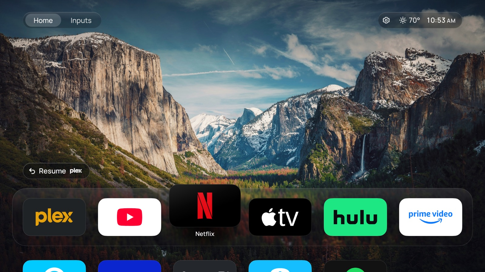
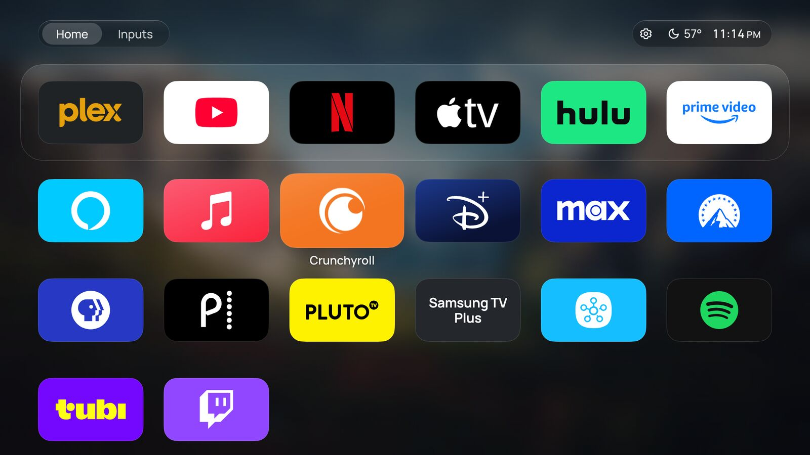
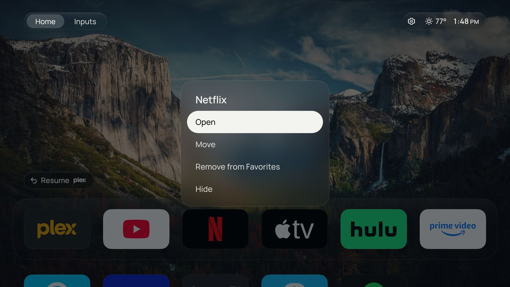
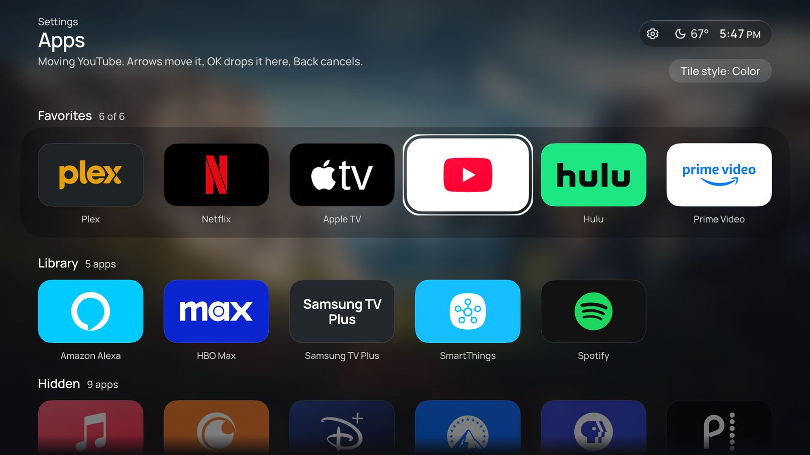
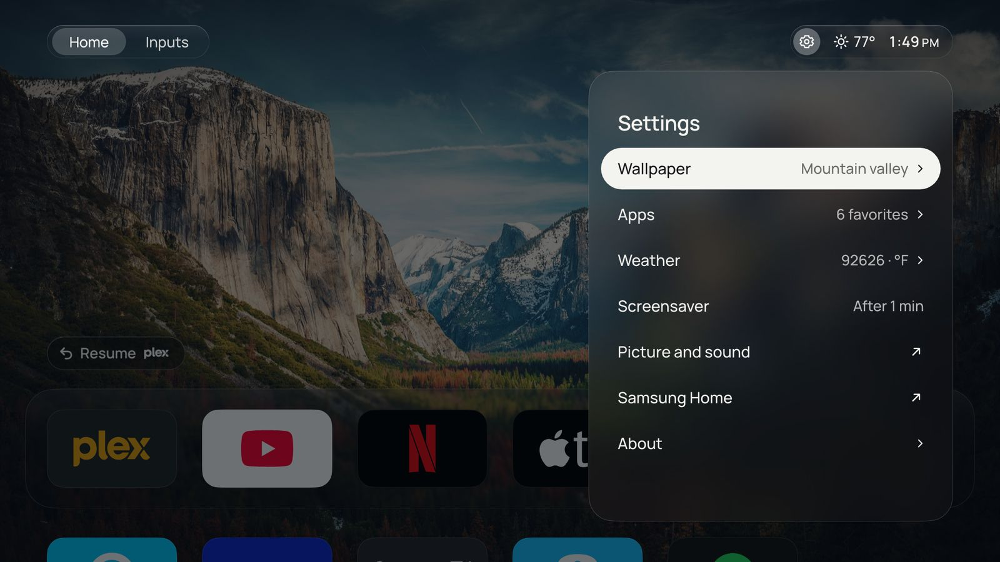
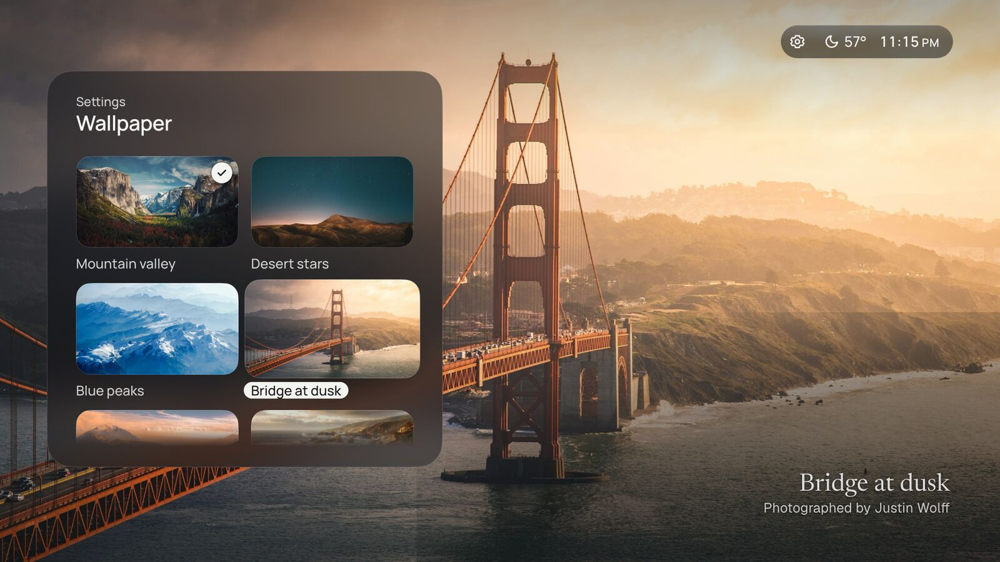
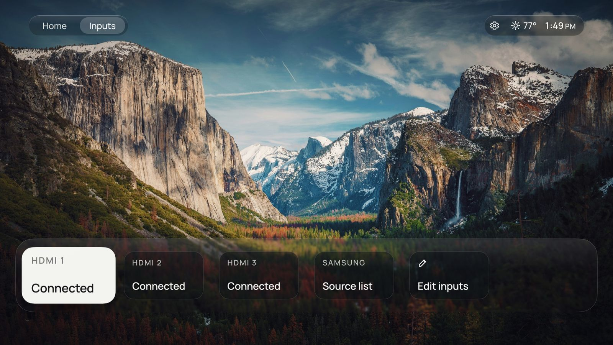
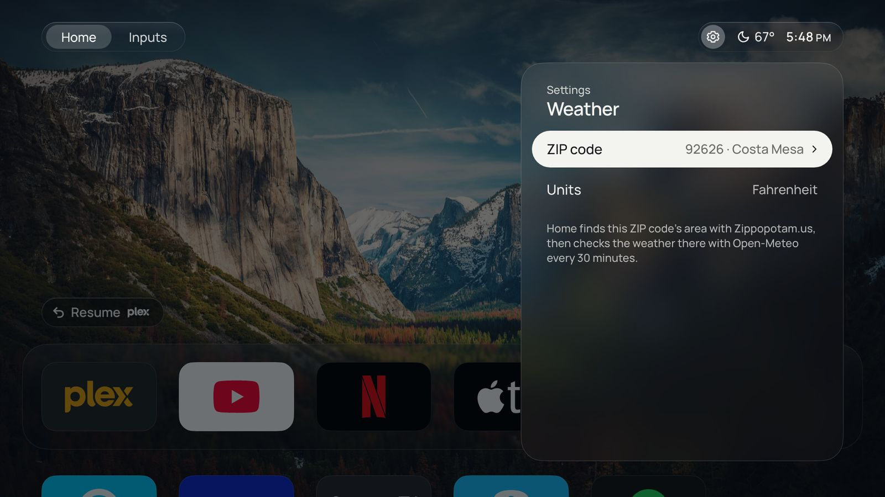
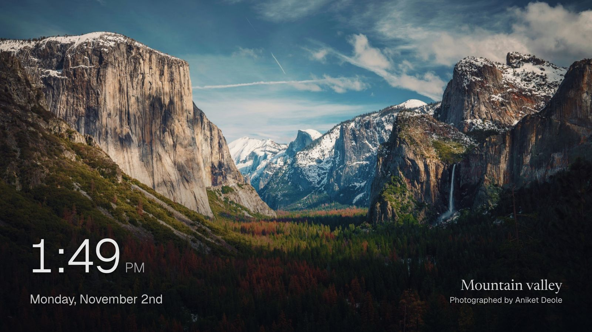

# Home

Home is my own launcher design for a Samsung QN65S90D (QD-OLED, Tizen 9). It is a signed Tizen web app that replaces Smart Hub, and the TV's Home button opens it. It is built on the foundations and processes of [CleanFrame](https://github.com/nthnclrk/CleanFrame) by Nathan Clark: Tizen packaging and signing, app listing and launching, local-secret hygiene and the check tooling.



## Features

- **Favourites dock and app library:** up to six favourites on a glass dock, then every other installed app A–Z in a grid that scrolls up beneath it.
- **Edit in place:** hold OK on any app to open, move, favourite or hide it. Settings › Apps rearranges everything and switches between colour and glass tiles.
- **Resume card:** reopens the last app launched from Home.
- **Clock and live weather:** current conditions for a ZIP code from Open-Meteo, cached so Home never waits on the network.
- **Daily photo or a bundled wallpaper:** a new Unsplash photo each day from Lorem Picsum, or one of 15 bundled photos, chosen in a full-screen picker. The glass panels are made from the photo.
- **Screensaver:** a large clock, the date and the photo credit over a slideshow of online photos, with slow drift to protect the OLED panel.
- **Inputs tab:** HDMI ports with names you set and whether a device is connected, plus Samsung's source list.
- **Settings:** wallpaper, apps, weather, screensaver delay, links to Samsung's picture and sound settings and Samsung Home, and an About page.
- **Remote-only and quiet:** no ads and no autoplay. Focus never acts; OK does.

## Screenshots

| | |
| --- | --- |
|  |  |
| App library, scrolled | Hold OK: edit in place |
|  |  |
| Settings › Apps, moving an app | Settings |
|  |  |
| Wallpaper picker | Inputs |
|  |  |
| Settings › Weather | Screensaver |

## Quick start

Requires Node.js 22.13+ or 24+ and Python 3.10+.

```sh
npm ci
npm run dev      # browser preview at http://localhost:4795/home/ (arrows, Enter = OK, Esc = Back)
npm run check    # lint, manifest and asset check, device-adapter and logic unit tests
npm run build    # unsigned Tizen web app in dist/home/
```

Sign a copy of `dist/home/` with the official Samsung SDK and your own certificate profile, then install the newest signed package:

```sh
tizen package -t wgt -s <profile> -o dist/signed-home-<time> -- <copy of dist/home>
npm run tv:install
```

[Development](docs/development.md) covers the TV setup, signing and install in detail; [testing](docs/testing.md) covers the browser checks (`npm run check:all`). The design spec is [docs/home-redesign.md](docs/home-redesign.md).

An optional, reversible helper makes the remote's Home button open Home (a cold power-on still shows Samsung Home); see [docs/native-home-s90d.md](docs/native-home-s90d.md).

## Licence and credits

Code and documentation are [MIT](LICENSE), shared with CleanFrame by [Nathan Clark](https://github.com/nthnclrk/CleanFrame). Fonts, photographs and brand marks keep their own terms; see [THIRD_PARTY_NOTICES.md](THIRD_PARTY_NOTICES.md). Not affiliated with Samsung or any streaming service.
